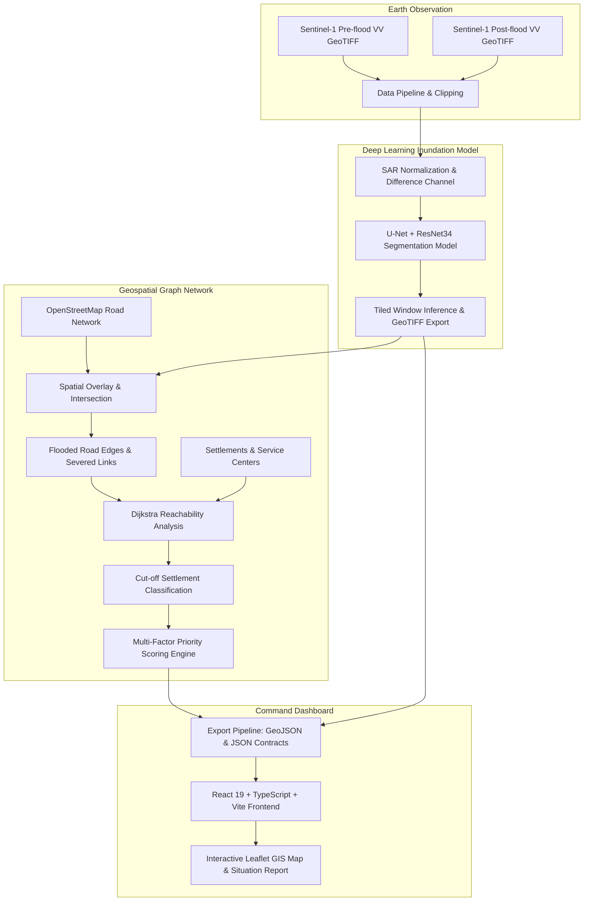

# SAHAYAK: Mapping Flood Damage from Space
### Satellite SAR Intelligence & Rescue Prioritization for Cut-Off Settlements

[]()
[]()
[]()
[]()

---

## 1. Problem Statement

During catastrophic monsoon floods in Assam, India (such as the June 2022 Kamrup disaster), optical satellite sensors (like Sentinel-2 or Landsat) are frequently blinded by dense cloud cover and persistent rainstorms. First responders and district disaster management authorities (DDMA) face critical operational blind spots:
- Traditional flood assessments arrive days late after optical imagery clears.
- Flooded road networks isolate rural settlements, severing road access to hospitals and emergency service centers.
- Disaster response teams lack objective, rapid data to decide **where to deploy air/boat rescue assets first**.

## 2. Proposed Solution

**SAHAYAK Flood Mapper** bridges the gap between raw earth observation radar data and real-time humanitarian logistics:
1. **All-Weather Satellite Radar**: Ingests Sentinel-1 Synthetic Aperture Radar (SAR) C-band VV polarization imagery (penetrates clouds, rain, and darkness).
2. **Deep Learning Segmentation**: Employs a U-Net architecture with a ResNet34 backbone to segment inundated surface water from SAR backscatter changes.
3. **Topological Road Network Routing**: Overlays inundation masks onto OpenStreetMap road networks to detect physically submerged road links and bridges.
4. **Graph Cut-Off Analysis**: Executes Dijkstra network reachability from 104 settlements to emergency service centers and hospitals to classify communities into **Strict Cut-Offs**, **Practical Cut-Offs** (extreme detours), and **Accessible Settlements**.
5. **Multi-Factor Rescue Ranking**: Computes an objective rescue priority score ($0 - 100$) combining isolation severity, estimated population, and distance to critical care.
6. **Command Dashboard**: Delivers an interactive dark-mode situational dashboard built in React 19, TypeScript, and Leaflet for disaster response coordinators.

---

## 3. Team & Contributions

- **Ravi**: Sentinel-1 SAR imagery acquisition and pre-processing pipeline (`data-pipeline/`).
- **Utkarsh**: Deep learning flood segmentation model, threshold calibration, and Experiment 01 (`ml-model/`).
- **Aryan**: Road network graph extraction, flood overlay, Dijkstra reachability, and settlement priority ranking (`graph-analysis/`).
- **Shashank**: Interactive geospatial dashboard, multi-scenario visualization, and responsive UI architecture (`frontend/`).

---

## 4. System Architecture



---

## 5. Technology Stack

- **Machine Learning & Geospatial Backend**:
  - Python 3.11
  - PyTorch & Torchvision (CUDA-accelerated)
  - `segmentation-models-pytorch` (U-Net with ResNet34)
  - Rasterio & GDAL (GeoTIFF manipulation & georeferencing)
  - Shapely, GeoPandas & PyProj (Geodesic area & geospatial geometry)
  - OSMnx & NetworkX (Graph topology, edge weighting, Dijkstra reachability)
- **Frontend Dashboard**:
  - React 19 & TypeScript
  - Vite 8 (Rolldown bundler)
  - Leaflet & React-Leaflet (Interactive mapping)
  - Tailwind CSS 4 & Framer Motion (Animations and micro-interactions)
  - Lucide React (Icons) & Oxlint (Static analysis)

---

## 6. Multi-Scenario Visualization

The dashboard supports three distinct disaster scenarios:

| Scenario | Data Source | Flood Extent | Cut-Off Settlements | Affected Population | Purpose |
| :--- | :--- | :--- | :--- | :--- | :--- |
| **Severe Baseline** | Synthetic flood mask | 1,950 ha | 15 | 31,800 | Benchmark testing for severe multi-basin inundation stress test |
| **Real Event** | SAR heuristic pseudo-label | ~3,500 ha | 0 | 0 | Historical baseline showing highway connectivity preserved |
| **Experimental ML** | U-Net Model (ResNet34) | 141,395 ha | 20 | 40,200 | Deep learning full-scene inference identifying 6,306 submerged road links (30.51%) |

---

## 7. Machine Learning Evaluation & Critical Disclaimers

### Model Evolution

- **Baseline Run 01**:
  - Input: 2 channels (`pre_flood_VV`, `post_flood_VV`)
  - Validation metrics ($\tau = 0.50$): F1: **0.1515**, IoU: **0.0820**, Precision: **9.15%**, Recall: **44.17%**
  - Observation: High false positives due to undertraining and missing change representation.
- **Experiment 01 (`exp01_diff_channel`)**:
  - Input: 3 channels (`pre_flood_VV`, `post_flood_VV`, and physical dB difference `post - pre`)
  - Stride 128 patch extraction (36 training patches), flip augmentations, AdamW optimizer with cosine annealing.
  - Validation metrics ($\tau = 0.50$): F1: **0.6996** ($+0.5481$), IoU: **0.5379** ($+0.4559$), Precision: **55.46%** ($+46.3\%$), Recall: **94.72%** ($+50.55\%$).
  - False positive pixels dropped by **82.7%** (from 38,328 down to 6,647).

> [!IMPORTANT]
> **Evaluation Caveat & Provenance**:
> Validation metrics measure agreement against **heuristic SAR pseudo-labels** (SAR change detection with slope filtering) on spatially held-out patches from the same Kamrup June 2022 scene.
> **They do NOT represent independently verified ground-truth accuracy.** Real-world flood accuracy requires in-situ GPS ground surveys and hydrological water gauge calibration.

---

## 8. Setup & Execution Instructions

### Prerequisites
- Node.js (v18+) and npm
- Python 3.11+
- Git

### Quickstart (Frontend Dashboard)

```powershell
cd frontend
npm install
npm run dev
```
Open [http://localhost:5173](http://localhost:5173) in your browser.

### Running Test Suites

```powershell
# Run ML & export pipeline regression test suite (39 tests)
& "ml-model/.venv/Scripts/python.exe" -m unittest discover -t ml-model -s ml-model/tests

# Run frontend production build
cd frontend
npm run build
```

### Reproducible End-to-End Orchestrator

To execute the offline pipeline orchestrator from the repository root:

```powershell
# Dry run verification
& "ml-model/.venv/Scripts/python.exe" ml-model/scripts/run_e2e_pipeline.py --dry-run

# Full execution (Inference -> Graph Overlay -> Routing -> Export -> Tests -> Build)
& "ml-model/.venv/Scripts/python.exe" ml-model/scripts/run_e2e_pipeline.py --threshold 0.5
```

---

## 9. 3–5 Minute Presentation / Demo Script

1. **The Hook (0:00 - 0:45)**:
   > *"When major floods strike Assam, cloud cover blinds regular satellites for weeks. SAHAYAK uses Sentinel-1 SAR radar satellites that see right through clouds and darkness to map floodwaters within hours of an orbit."*

2. **The Problem with Pixels Alone (0:45 - 1:30)**:
   > *"A flood map alone doesn't tell a rescue commander what to do. Having 10,000 flooded pixels is useless unless you know which roads are submerged and which villages are stranded. SAHAYAK connects satellite pixels directly to OpenStreetMap road networks."*

3. **The Live Demo (1:30 - 3:00)**:
   - *Navigate to the dashboard Overview.*
   - *Point out the Leaflet map: Dark carto basemap with blue flood extents and color-coded settlement markers.*
   - *Show the Scenario Switcher: Toggle between Severe, Real Event, and Experimental ML (U-Net).*
   - *Highlight the Experimental ML Scenario: Point out the purple banner explaining the U-Net inference, the 6,306 submerged road segments, and the 20 isolated communities.*
   - *Inspect a high-priority settlement: Click on Amingaon or Jalukbari to view population, priority score (76.32), and cutoff distance.*
   - *Demonstrate CSV export: Click 'Download CSV' to show export ready for field dispatch.*

4. **Honest ML Findings & Road Ahead (3:00 - 4:00)**:
   > *"In our controlled Experiment 01, adding a physical SAR difference channel and geometric augmentations boosted validation F1 from 0.15 to 0.70 against our held-out validation patches. We are completely transparent that these metrics evaluate against radar pseudo-labels, not field truth. Our next step is pairing with local SDRF ground teams for in-situ GPS calibration."*

---

## 10. Known Limitations & Future Work

1. **Radar Shadow & Specular False Positives**:
   - Smooth dry surfaces (airport runways, flat asphalt) and steep topographic shadows can exhibit low SAR backscatter resembling water. Slope masking and difference thresholds help mitigate this, but multi-temporal radar stacks are needed for complete suppression.
2. **Road Elevation & Bridge Crossings**:
   - The current graph overlay treats 2D intersection between flood polygons and road centerlines as submerged. Elevated highways and raised embankments may remain passable even if surrounding fields are inundated.
3. **Static Deployment Architecture**:
   - To guarantee zero downtime, offline reproducibility, and sub-second page loads during disaster response without cloud GPU server dependencies, the application compiles verified static GeoJSON/JSON contracts.
